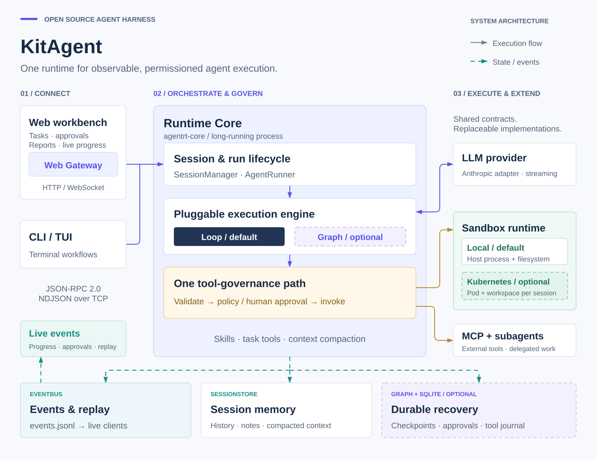

<div align="center">

<h1>KitAgent</h1>

<p><strong>Run your AI agent from the browser or terminal</strong></p>

<p>An open-source AI agent runtime and visual workbench</p>
<p><sub>Conversational tasks · Live tool tracking · Human approval · Session memory · Kubernetes sandboxes</sub></p>

<p>
  <a href="https://github.com/zed123214/agent-runtime-kit/actions/workflows/ci.yml"></a>
  <a href="https://www.python.org/"></a>
  <a href="frontend/package.json"></a>
  <a href="docs/kubernetes-sandbox.md"></a>
  <a href="LICENSE"></a>
</p>

[中文](README.md) · **English**

[Demo](#demo) · [Features](#features) · [Architecture](#architecture) · [Quick Start](#quick-start) · [Documentation](#docs)

</div>

---

KitAgent is for developers who build and use AI automation tools. Describe a task in your browser or terminal, let the agent read your project, run commands, and edit files, then continue in the same conversation. Use the workbench to inspect tool calls, handle approvals, follow subtasks, and export a report for each run.

A persistent **Core** manages execution and sessions, with **Web / CLI / TUI** interfaces, **Loop / LangGraph** engines, and **Local / Kubernetes** tool environments.

<a id="demo"></a>

## 📸 Demo

**From a task description to results you can inspect and export.**


<p align="center">
  Sessions · Multi-turn chat · Tool timeline · Run reports<br />
  <a href="docs/assets/web-workbench-overview.png">Full-resolution screenshot</a> · <a href="https://raw.githubusercontent.com/zed123214/agent-runtime-kit/main/docs/assets/web-workbench-demo.webm">Download the full video</a> · <a href="docs/web-workbench.md">Launch the workbench</a>
</p>

For a repository check, start with:

> Inspect the sample Python repository, run its check script, and write a report.

| Step | What you see in the workbench |
| --- | --- |
| **① Describe the goal** | Create a session and submit a task in natural language. |
| **② Follow execution** | Read agent responses, tool arguments, execution status, and output. |
| **③ Make decisions** | Approve or reject calls, and remember tool grants for the session. |
| **④ Use the result** | Review the conclusion, tools, and approvals; export the report and continue chatting. |

<details>
<summary><strong>See tool calls and human approval</strong></summary>


Choose Read-only, Ask as needed, or Auto-approve for a session. View and revoke remembered tool grants from the permission menu.

</details>

<p align="center"><sub>Built-in offline demo · Scripted model responses + live tool execution · <a href="docs/web-workbench.md#无-api-key-的真实工具演示">Try it locally</a></sub></p>

<a id="features"></a>

## ✨ Features

### One Core, three interfaces

Chat, approve calls, and inspect reports in the **Web workbench**. Submit tasks and integrate scripts through the **CLI**, or work in the terminal with the **Textual TUI**. All three interfaces share the runtime protocol, with Core managing task and session state.

The Web gateway maintains its Core connection, so you can refresh the browser and keep following an active task.

### Execution you can inspect

Follow streaming responses and a tool timeline to see which tools ran, their inputs, outputs, and timing. Each run records events in `events.jsonl` for replay; correlation IDs connect parent and child tasks.

Export a run report with the conclusion, tool output, and approval records for review or sharing.

### Collaboration and tool approval

Add requirements and adjust direction through multi-turn conversation. Use approval cards to decide whether a tool should run, remember a tool grant for the session, or revoke it from the permission menu.

Built-in tools and MCP tools share registration, argument validation, permission policies, and execution records.

### Session memory and extensions

Keep conversation history, long-term notes, and compact summaries across turns. Package workflows as Markdown **Skills**, connect external tools through **MCP**, and delegate independent work to **Subagents** with their own contexts.

### Engine choice and durable recovery

Use the default **Loop** engine for model–tool execution or **LangGraph** for explicit node orchestration. With **Graph + SQLite + Local**, save checkpoints and approval interrupts, resume after a Core restart, and reuse recorded tool results.

### Kubernetes workspaces per session

Use **Local** tools for development, or enable **Kubernetes Sandbox** to create a Pod on demand for each session. Turns and subagents within a session share the workspace, with resource limits, network policies, idle reclamation, and cleanup on close.

<a id="architecture"></a>

## 🏗️ Architecture



<p align="center">
  <a href="docs/assets/architecture.en.png">High-resolution PNG</a> · <a href="docs/assets/architecture.drawio">Editable draw.io source</a> · <a href="docs/architecture.md">Architecture details</a>
</p>

**Follow a task:** submit a goal → Core creates a run → engine calls the model → approve and execute tools → stream events → commit the session result.

| Layer | Technology and responsibility |
| --- | --- |
| **Interfaces** | React 19, TypeScript, assistant-ui, Textual; Web, CLI, and TUI. |
| **Transport** | FastAPI and WebSocket; the gateway connects to Core through JSON-RPC 2.0 / NDJSON TCP. |
| **Runtime** | Python 3.12, asyncio, Pydantic v2; sessions, tasks, permissions, and events. |
| **Engines** | Loop / LangGraph; shared model, tool, and session interfaces. |
| **Model integration** | Anthropic Provider; server-side model and API key configuration. |
| **Tool environments** | Local / Kubernetes; command execution and file operations. |
| **Storage and extensions** | JSONL, Markdown, SQLite; replay, memory, recovery, Skills, and MCP. |

## 📊 Measured Results

Sandbox validation completed on **September 9, 2026**, using **single-node kind / Kubernetes v1.36.4 / Cilium 1.20.1**, an offline provider, and preloaded images.

| Check | Result |
| --- | --- |
| **Live-cluster validation** | M1 **13/13**, M2 **442/442**, across 12 experiment categories. |
| **Concurrent session isolation** | **20** sessions, **200** cross-session read/write probes, **0** leaks. |
| **Creation and cleanup** | **100/100** completed, **0** resources left at the end. |
| **Sandbox cold start** | **3.52 s** p95 to Ready, 30 serial samples. |
| **Execution overhead after Ready** | **19.26 ms** p95, 100 samples; Core duration minus Worker command duration. |

[Sandbox configuration and validation walkthrough →](docs/kubernetes-sandbox.md#构建渲染与后续验收)

<a id="quick-start"></a>

## 🚀 Quick Start

Run these commands in **Bash on Linux / WSL2**. Install **Python 3.12** and [uv](https://docs.astral.sh/uv/). The Web workbench also needs **Node.js 22.12+** to build its frontend.

### 1. Install and configure the model

```bash
git clone https://github.com/zed123214/agent-runtime-kit.git
cd agent-runtime-kit
uv sync --frozen --extra web
cp .env.example .env
```

Edit `.env` with your model configuration:

```dotenv
ANTHROPIC_API_KEY=your-api-key
AGENTRT_LLM_DEFAULT_MODEL=claude-sonnet-4-6
```

### 2. Build the workbench

```bash
cd frontend
npm ci
npm run build
cd ..
```

### 3. Start Core and the Web gateway

Open two terminals in the repository root.

**Terminal one · Core**

```bash
uv run --frozen --extra web agentrt-core
```

**Terminal two · Web gateway**

```bash
uv run --frozen --extra web agentrt-web
```

Open the gateway's startup link (`http://localhost:8765/#bootstrap=…`), create a session, and submit your first task. The default is **Loop + Local**, with tools running in Core's working directory.

### Prefer the terminal?

With Core running, use the CLI or TUI in another terminal:

```bash
# Check the connection
uv run --frozen --extra web agentrt ping

# Submit a task
uv run --frozen --extra web agentrt run --goal "Read the project structure and summarize the main modules"

# Open the terminal interface
uv run --frozen --extra web agentrt-tui
```

<details>
<summary><strong>No API key needed: try the engine and cross-process recovery</strong></summary>

Run the offline model → tool → model example:

```bash
uv run --frozen --extra graph python examples/graph_offline_demo.py
```

Resume a task after a Core restart and reuse completed tool results:

```bash
uv run --frozen --extra graph-sqlite python examples/durable_recovery_demo.py
```

For an offline browser demo, see the [workbench guide](docs/web-workbench.md#无-api-key-的真实工具演示).

</details>

### Choose a runtime mode

| Mode | Use case | Guide |
| --- | --- | --- |
| **Loop + Local** | Web workbench, local development, and everyday tasks | [Workbench](docs/web-workbench.md) · [Runbook](RUNBOOK.md) |
| **Graph + Memory** | Explicit node orchestration and in-process session continuation | [Graph engine](docs/graph-engine.md) |
| **Graph + SQLite + Local** | Core restart recovery and durable human approval | [Recovery](docs/durable-recovery.md) |
| **Loop / Graph Memory + Kubernetes** | Container workspaces per session | [Sandbox deployment](docs/kubernetes-sandbox.md) |

<a id="docs"></a>

## 📚 Documentation

| I want to… | Start here |
| --- | --- |
| Use the browser workbench | [Web workbench](docs/web-workbench.md) |
| Configure and run the project | [Runbook](RUNBOOK.md) |
| Follow task execution | [Architecture](docs/architecture.md) · [Agent Loop](docs/agent-loop.md) |
| Use Graph and recovery | [Graph engine](docs/graph-engine.md) · [Durable recovery](docs/durable-recovery.md) |
| Deploy Kubernetes sandboxes | [Deployment and validation](docs/kubernetes-sandbox.md) |
| Configure permissions and memory | [Tool permissions](docs/tool-permissions.md) · [Session memory](docs/session-memory.md) |
| Extend workflows and tools | [Skills / Subagents / MCP](docs/skills-subagents-mcp.md) |
| Build a client or contribute | [Wire protocol](WIRE_PROTOCOL.md) · [Contributing](CONTRIBUTING.md) |

## 🤝 Contributing

Share use cases, report bugs through [Issues](https://github.com/zed123214/agent-runtime-kit/issues), or open a pull request. See [CONTRIBUTING.md](CONTRIBUTING.md) for development setup and checks.

If KitAgent helps with your work, give it a **Star** and share what you built with it.

## 📄 License

[MIT](LICENSE)
