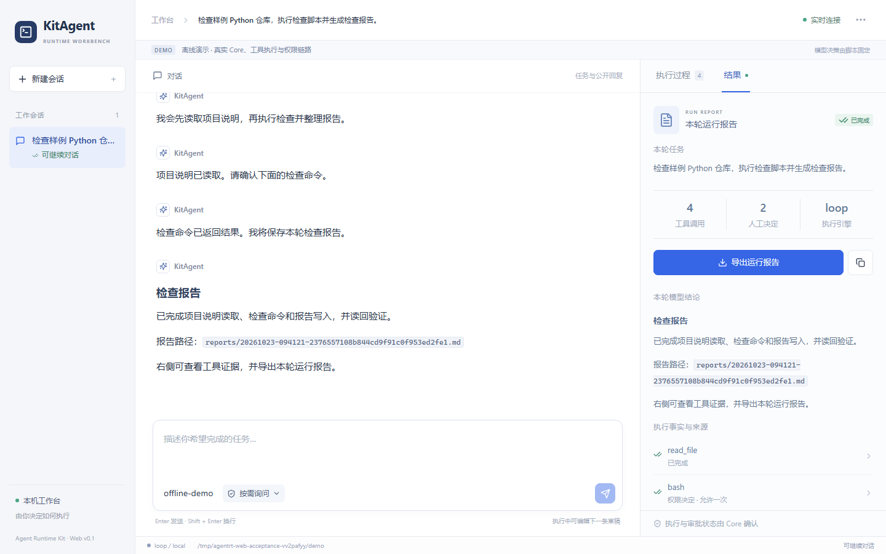
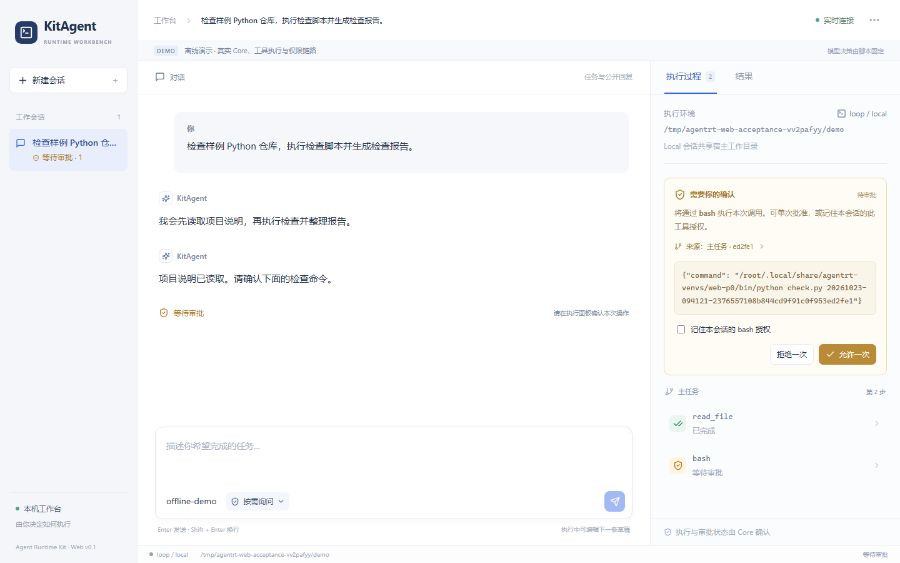
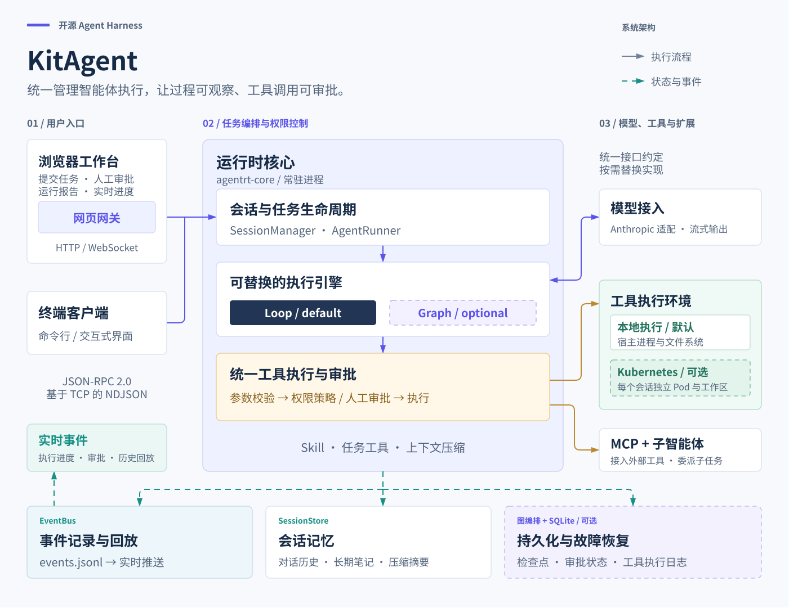

<div align="center">

<h1>KitAgent</h1>

<p><strong>在浏览器与终端中，运行你的 AI Agent</strong></p>

<p>开源 AI Agent 运行时与可视化工作台</p>
<p><sub>对话驱动任务 · 实时工具追踪 · 人工审批 · 会话记忆 · Kubernetes 沙箱</sub></p>

<p>
  <a href="https://github.com/zed123214/agent-runtime-kit/actions/workflows/ci.yml"></a>
  <a href="https://www.python.org/"></a>
  <a href="frontend/package.json"></a>
  <a href="docs/kubernetes-sandbox.md"></a>
  <a href="LICENSE"></a>
</p>

**中文** · [English](README.en.md)

[产品演示](#demo) · [核心能力](#features) · [系统架构](#architecture) · [快速开始](#quick-start) · [文档导航](#docs)

</div>

---

KitAgent 面向希望构建和使用 AI 自动化工具的开发者。你可以在浏览器或终端中描述任务，让 Agent 阅读项目、执行命令、修改文件，并在同一会话中继续协作。通过工作台，你能查看每次工具调用、处理审批、追踪子任务，并导出本轮运行报告。

项目以常驻 **Core** 管理执行与会话，提供 **Web / CLI / TUI** 三种交互入口，支持 **Loop / LangGraph** 执行引擎，以及 **Local / Kubernetes** 工具环境。

<a id="demo"></a>

## 📸 产品演示

**从一句任务描述，到可查看、可导出的执行结果。**



<p align="center">
  会话管理 · 多轮对话 · 工具时间线 · 运行报告<br />
  <a href="docs/assets/web-workbench-demo.webm"><strong>▶ 观看完整演示</strong></a> · <a href="docs/web-workbench.md">启动工作台</a>
</p>

以仓库检查为例：

> 检查样例 Python 仓库，执行检查脚本并生成检查报告。

| 步骤 | 你在工作台中看到的内容 |
| --- | --- |
| **① 描述目标** | 新建会话，用自然语言提交任务。 |
| **② 观察执行** | 查看 Agent 回复、工具参数、执行状态与输出。 |
| **③ 参与决策** | 在审批卡片中批准或拒绝调用，也可记住本会话的工具授权。 |
| **④ 获取结果** | 查看本轮结论、工具记录与审批记录，导出运行报告后继续对话。 |

<details>
<summary><strong>展开查看：工具调用与人工审批</strong></summary>



工作台提供「只读 / 按需询问 / 自动批准」三种会话权限模式，并支持查看和撤销已记住的工具授权。

</details>

<p align="center"><sub>内置离线演示 · 脚本化模型响应 + 实际工具执行 · <a href="docs/web-workbench.md#无-api-key-的真实工具演示">在本机体验</a></sub></p>

<a id="features"></a>

## ✨ 核心能力

### 一个 Core，三种交互方式

在 **Web 工作台**中对话、审批和查看报告，在 **CLI** 中提交任务与接入脚本，在 **Textual TUI** 中进行终端交互。三种入口共用运行时协议，任务执行和会话状态由 Core 管理。

Web 网关持续连接 Core，刷新浏览器后可以继续观察正在执行的任务。

### 看得见的执行过程

通过流式回复和工具时间线查看任务进展：调用了什么工具、输入是什么、结果如何、用了多久。每次运行的事件保存到 `events.jsonl`，支持历史回放；父任务与子任务通过关联标识串联。

运行报告汇集本轮结论、工具输出和审批记录，方便复盘与分享。

### 多轮协作与工具审批

通过多轮对话补充要求、调整任务方向；通过审批卡片决定工具是否执行。你可以为当前会话记住某个工具的授权，也可以从权限菜单中撤销。

工具注册、参数校验、权限策略和执行记录采用同一套机制，内置工具与 MCP 工具都能接入。

### 会话记忆与能力扩展

会话历史、长期笔记和压缩摘要分层保存，让 Agent 在后续轮次中沿用已有信息。使用 Markdown **Skills** 封装工作流程，通过 **MCP** 连接外部工具，将独立子任务交给拥有各自上下文的 **Subagents**。

### 执行引擎与持久化恢复

默认 **Loop** 引擎运行模型与工具循环；可选 **LangGraph** 引擎提供显式节点编排。启用 **Graph + SQLite + Local** 后，可保存执行检查点与审批中断，在 Core 重启后续接任务，并复用已经记录的工具结果。

### 按会话组织的 Kubernetes 沙箱

本地开发使用 **Local** 工具环境；需要独立工作区时，启用 **Kubernetes Sandbox**，为每个会话按需创建 Pod。同一会话中的多轮任务与子 Agent 共用工作区，支持资源限制、网络策略、空闲回收和关闭清理。

<a id="architecture"></a>

## 🏗️ 系统架构



<p align="center">
  <a href="docs/assets/architecture.png">高清 PNG</a> · <a href="docs/assets/architecture.drawio">可编辑 draw.io 源文件</a> · <a href="docs/architecture.md">架构设计详解</a>
</p>

**任务路径：** 提交目标 → Core 创建任务 → 执行引擎调用模型 → 工具审批与执行 → 事件推送 → 会话结果。

| 层次 | 技术与职责 |
| --- | --- |
| **交互层** | React 19、TypeScript、assistant-ui、Textual；提供 Web、CLI 与 TUI。 |
| **连接层** | FastAPI、WebSocket；网关通过 JSON-RPC 2.0 / NDJSON TCP 连接 Core。 |
| **运行时** | Python 3.12、asyncio、Pydantic v2；管理会话、任务、权限与事件。 |
| **执行引擎** | Loop / LangGraph；复用模型、工具和会话接口。 |
| **模型接入** | Anthropic Provider；通过服务端配置设置模型与 API Key。 |
| **工具环境** | Local / Kubernetes；承载命令执行与文件操作。 |
| **持久化与扩展** | JSONL、Markdown、SQLite；支持事件回放、记忆、恢复、Skills 与 MCP。 |

## 📊 工程实测

2026-09-09，在 **单节点 kind / Kubernetes v1.36.4 / Cilium 1.20.1** 环境完成沙箱验收，使用离线 Provider 与预加载镜像。

| 验证项 | 结果 |
| --- | --- |
| **真实集群验收** | M1 **13/13**，M2 **442/442**，覆盖 12 类实验。 |
| **并发会话隔离** | **20** 个 Session，**200** 次跨会话读写探测，泄漏 **0**。 |
| **创建与回收** | **100/100** 完成，最终资源残留 **0**。 |
| **沙箱冷启动** | 到 Ready 的 p95 为 **3.52 s**，30 个样本、串行采样。 |
| **就绪后执行开销** | p95 **19.26 ms**，100 个样本，按 Core 总耗时减 Worker 命令耗时计算。 |

[查看沙箱配置与验收复现入口 →](docs/kubernetes-sandbox.md#构建渲染与后续验收)

<a id="quick-start"></a>

## 🚀 快速开始

以下命令在 **Linux / WSL2 的 Bash** 中运行。准备 **Python 3.12**、[uv](https://docs.astral.sh/uv/)；Web 工作台还需要 **Node.js 22.12+** 构建前端。

### 1. 安装并配置模型

```bash
git clone https://github.com/zed123214/agent-runtime-kit.git
cd agent-runtime-kit
uv sync --frozen --extra web
cp .env.example .env
```

编辑 `.env`，填写模型服务配置：

```dotenv
ANTHROPIC_API_KEY=your-api-key
AGENTRT_LLM_DEFAULT_MODEL=claude-sonnet-4-6
```

### 2. 构建工作台

```bash
cd frontend
npm ci
npm run build
cd ..
```

### 3. 启动 Core 与 Web 网关

在项目根目录打开两个终端。

**终端一 · Core**

```bash
uv run --frozen --extra web agentrt-core
```

**终端二 · Web 网关**

```bash
uv run --frozen --extra web agentrt-web
```

打开网关输出的启动链接（`http://localhost:8765/#bootstrap=…`），新建会话，即可提交第一条任务。默认使用 **Loop + Local**，工具在 Core 的工作目录中执行。

### 也可以从终端开始

Core 启动后，在另一个终端使用 CLI 或 TUI：

```bash
# 检查连接
uv run --frozen --extra web agentrt ping

# 提交任务
uv run --frozen --extra web agentrt run --goal "阅读项目结构，整理主要模块及其职责"

# 打开终端交互界面
uv run --frozen --extra web agentrt-tui
```

<details>
<summary><strong>无需 API Key：体验执行引擎与跨进程恢复</strong></summary>

运行模型 → 工具 → 模型的离线示例：

```bash
uv run --frozen --extra graph python examples/graph_offline_demo.py
```

体验 Core 重启后续接任务、复用已完成的工具结果：

```bash
uv run --frozen --extra graph-sqlite python examples/durable_recovery_demo.py
```

浏览器离线演示见[工作台说明](docs/web-workbench.md#无-api-key-的真实工具演示)。

</details>

### 选择运行模式

| 模式 | 适用场景 | 使用指南 |
| --- | --- | --- |
| **Loop + Local** | 浏览器工作台、本地开发与日常任务 | [工作台](docs/web-workbench.md) · [运行手册](RUNBOOK.md) |
| **Graph + Memory** | 显式节点编排与进程内会话续接 | [Graph 引擎](docs/graph-engine.md) |
| **Graph + SQLite + Local** | Core 重启恢复与持久化人工审批 | [恢复配置](docs/durable-recovery.md) |
| **Loop / Graph Memory + Kubernetes** | 按会话分配的容器工作区 | [沙箱部署](docs/kubernetes-sandbox.md) |

<a id="docs"></a>

## 📚 文档导航

| 我想…… | 从这里开始 |
| --- | --- |
| 使用浏览器工作台 | [Web 工作台](docs/web-workbench.md) |
| 配置并运行项目 | [运行手册](RUNBOOK.md) |
| 理解任务执行链路 | [系统架构](docs/architecture.md) · [Agent Loop](docs/agent-loop.md) |
| 使用 Graph 与故障恢复 | [Graph 引擎](docs/graph-engine.md) · [持久化恢复](docs/durable-recovery.md) |
| 部署 Kubernetes 沙箱 | [部署指南与验收复现](docs/kubernetes-sandbox.md) |
| 配置权限和会话记忆 | [工具权限](docs/tool-permissions.md) · [会话记忆](docs/session-memory.md) |
| 扩展工作流程与工具 | [Skills / Subagents / MCP](docs/skills-subagents-mcp.md) |
| 开发客户端或参与贡献 | [通信协议](WIRE_PROTOCOL.md) · [贡献指南](CONTRIBUTING.md) |

## 🤝 参与贡献

欢迎通过 [Issues](https://github.com/zed123214/agent-runtime-kit/issues) 分享使用场景、反馈问题，或提交 Pull Request。开发环境与检查命令见 [CONTRIBUTING.md](CONTRIBUTING.md)。

如果 KitAgent 对你有帮助，欢迎点一个 **Star**，也欢迎分享你用它完成的任务。

## 📄 License

[MIT](LICENSE)
